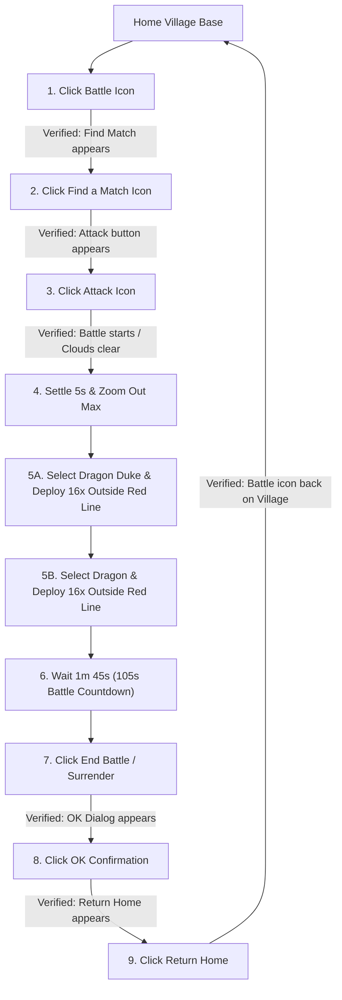
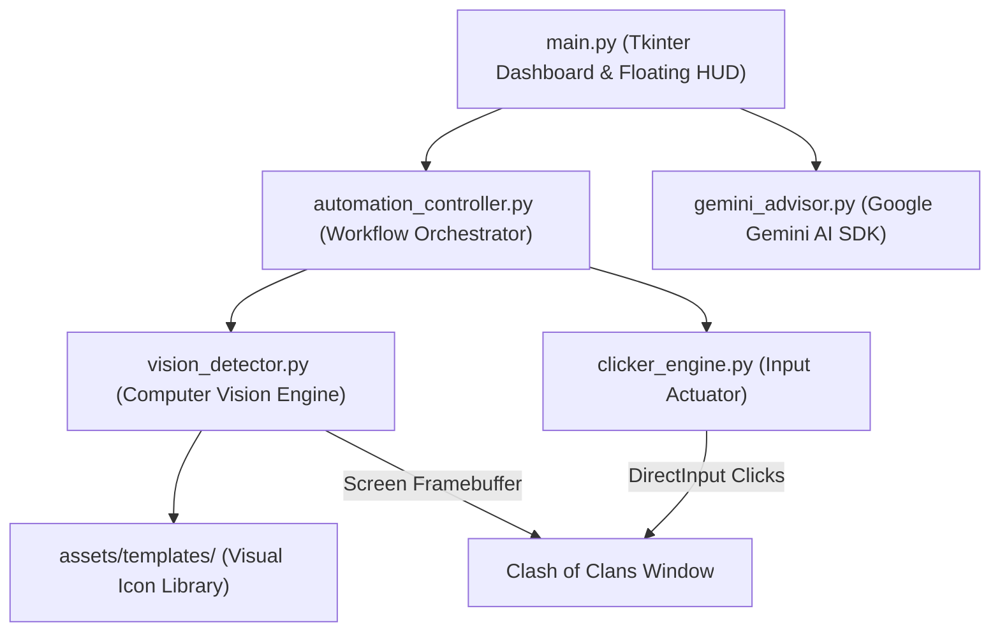

# ⚔️ COC Attacker Bot

[](https://www.python.org/)
[](https://www.microsoft.com/windows)
[](https://opencv.org/)
[](https://ai.google.dev/)
[](LICENSE)

An autonomous, vision-driven desktop automation bot for **Clash of Clans** on Windows (Google Play Games PC, BlueStacks, LDPlayer). 

Unlike legacy bots that rely on fragile hardcoded pixel coordinates, **COC Attacker Bot** operates purely through **dynamic computer vision template matching** and **hardware-level input actuation**. It incorporates a **strict state-verification handshake** that guarantees an action has registered before progressing to the next step.

---

## 🌟 Key Features

- **Strict State-Verified Handshake (`click_and_verify`)**:
  - Eliminates false positive logs. Every button click is immediately verified against the expected screen state (e.g. verifying the Match screen appears before looking for the Match button).
  - Automatically retries clicks with window refocusing if a transition is delayed.
- **Dual Dragon Deployment**:
  - Automatically selects and deploys **both Dragon Duke (`drag_duke.png`) and Electro Dragons/Dragons (`dragon.png`)** identically across 16 distinct perimeter drop points outside the red line.
- **DirectInput / Win32 Hardware Actuation**:
  - Dispatches native Windows `mouse_event` signals with humanized hold times (60ms–90ms) to ensure 100% input delivery into hardware-accelerated DirectX emulators and Google Play Games PC.
- **Automatic Disconnection Recovery**:
  - Visually detects the *"Anyone there? You have been disconnected due to inactivity"* popup, automatically clicks **RELOAD GAME**, and waits for the village to reload.
- **Dual-Backend Vision Engine**:
  - High-speed `mss` screen grab with seamless, automatic fallback to `PIL.ImageGrab` to handle hardware overlay BitBlt locks.
  - Multi-scale normalized template matching (`cv2.TM_CCOEFF_NORMED`) spanning scales `0.50x` to `1.25x` with transparency mask support.
- **Tactical AI Advisor (Google Gemini 3.1 Flash-Lite)**:
  - 1-click live base screenshot analysis. Gemini evaluates enemy loot, defensive weak points, and optimal dragon funnel angles.
- **Interactive UI & Miniature Floating HUD**:
  - Sleek dark Clash-themed GUI with live terminal logging, visual icon library manager, icon snipper, and an always-on-top floating button.

---

## 🔄 Autonomous 10-Step Attack Sequence



---

## 🏗️ System Architecture



---

## 🚀 Quick Start

### 1-Click Launch:
Double-click `run.bat` in the project root:
```bat
run.bat
```
*(Automatically verifies Python, installs any missing dependencies from `requirements.txt`, and launches the bot!)*

### Manual Setup:
1. Clone or download this repository:
   ```powershell
   git clone https://github.com/Dhruv-Gupta-1/coc-attack-automation.git
   cd coc-attacker-bot
   ```
2. Install requirements:
   ```powershell
   pip install -r requirements.txt
   ```
3. Run the dashboard:
   ```powershell
   python main.py
   ```

*For complete setup instructions and emulator configuration, read [INSTALL.md](INSTALL.md).*

---

## 🔑 Gemini AI Configuration

The application only requires your **Google Gemini API Key** for the optional AI Advisor tab:
1. Obtain a free key from [Google AI Studio](https://aistudio.google.com/).
2. On first launch, the app prompts you to enter your key, or click **"🔑 Gemini API"** in the top header.
3. Alternatively, add your key to `config.json`:
   ```json
   {
     "gemini_api_key": "YOUR_KEY_HERE",
     "gemini_model": "gemini-3.1-flash-lite"
   }
   ```
*(Note: If you do not have an API key, the bot's visual attack cycles and loot harvesting work 100% autonomously without it!)*

---

## 📁 Repository Structure

```
COC ATTACKER BOT/
├── assets/
│   ├── templates/               # In-game visual templates (.png)
│   │   ├── attack.png           # Green Attack button
│   │   ├── battle.png           # Yellow village Battle button
│   │   ├── drag_duke.png        # Dragon Duke hero icon
│   │   ├── dragon.png           # Dragon / Electro Dragon icon
│   │   ├── end_battle.png       # Red End Battle button
│   │   ├── find_a_match.png     # Yellow Find a Match button
│   │   ├── okay.png             # Green OK confirmation button
│   │   ├── reload_game.png      # Inactivity reconnect button
│   │   ├── return_home.png      # Green Return Home button
│   │   └── surrender.png        # Red Surrender button
│   ├── coc_logo.ico             # Application icon
│   └── coc_logo.png             # Application logo
├── automation_controller.py     # State-verified 10-step handshake engine
├── clicker_engine.py            # Low-level Win32 hardware clicks & troop deployer
├── vision_detector.py           # Multi-scale OpenCV template matching & screen grab
├── gemini_advisor.py            # Google Gemini AI strategist
├── icon_snipper.py              # Visual screen snippet tool for new icons
├── coc_floating_widget.py       # Compact desktop floating HUD widget
├── create_coc_shortcut.py       # Desktop shortcut generator
├── config.py                    # Configuration manager
├── config.json                  # User configuration file
├── main.py                      # Main Tkinter desktop dashboard
├── requirements.txt             # Python dependencies
├── run.bat                      # 1-click Windows launcher
├── .gitignore                   # Git ignore file
├── LICENSE                      # MIT Open Source License
├── INSTALL.md                   # Installation & setup guide
└── README.md                    # Project documentation
```

---

## 🛡️ Safety & Failsafe

- **Mouse Corner Failsafe**: Slam your mouse cursor to the top-left corner `(0, 0)` of your screen to immediately trip PyAutoGUI's safety abort.
- **Emergency Stop**: Click **"⏹ STOP ATTACK CYCLE"** on the GUI or floating HUD at any time to halt operations cleanly.

---

## 📄 License

Distributed under the **MIT License**. See [LICENSE](LICENSE) for details.

*Disclaimer: Clash of Clans is a registered trademark of Supercell. This open-source tool is developed for educational and accessibility research.*
